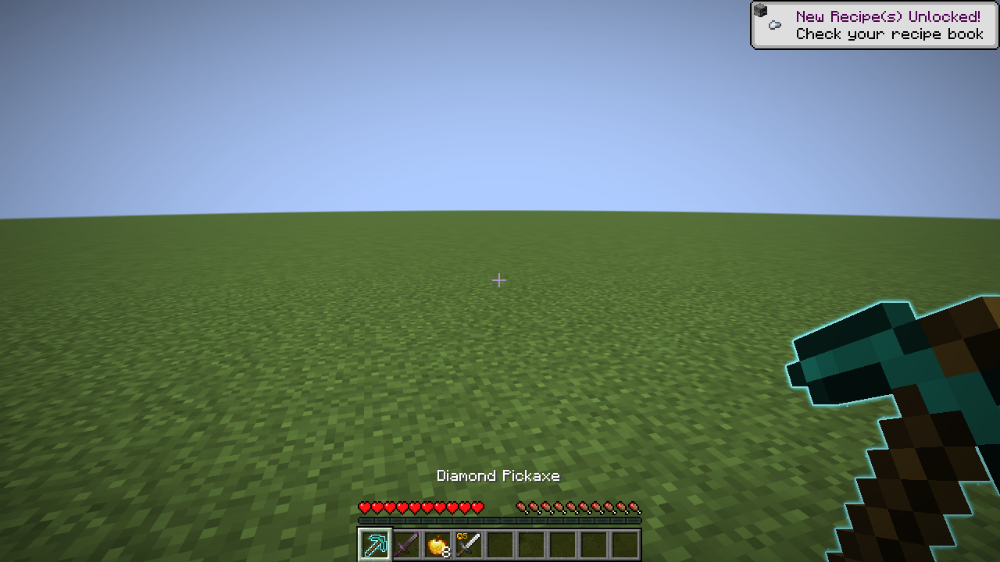
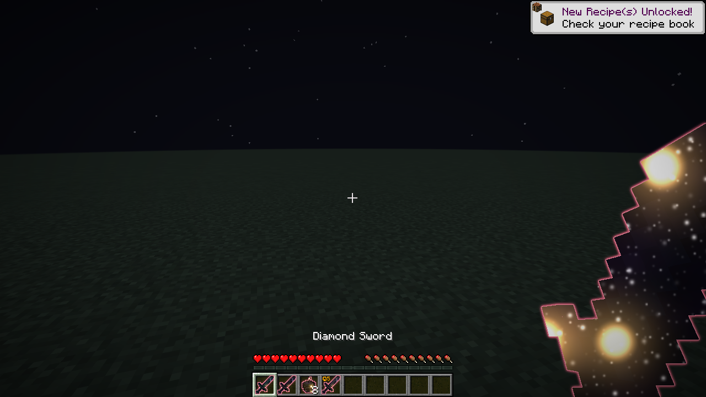
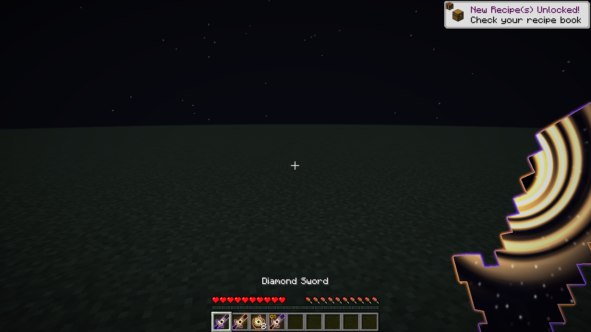
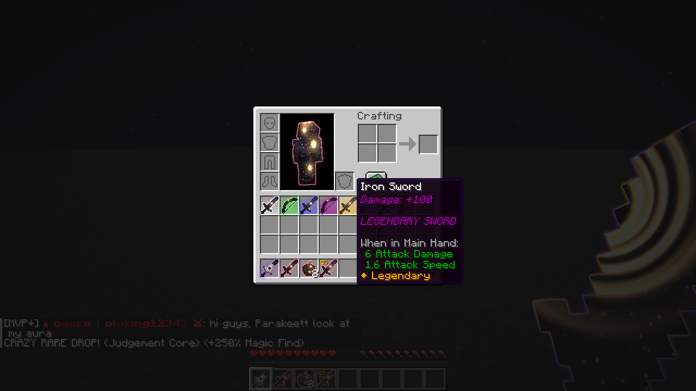
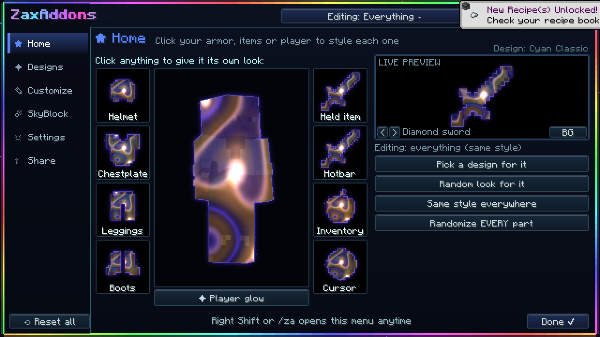
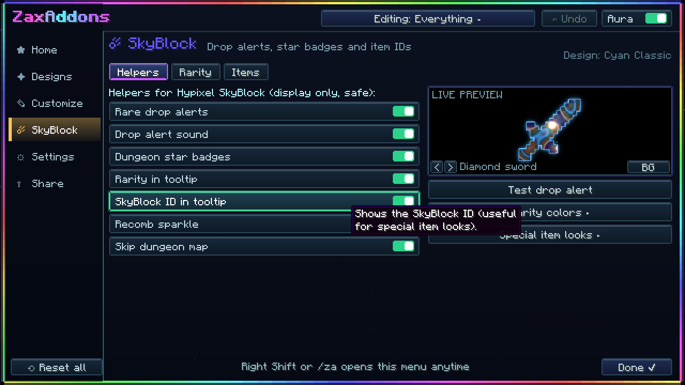

# ✦ Zax Addons 1.0.0 ✦

**Hypixel SkyBlock helpers, M7 timers, neon outlines and cosmetics for Minecraft 26.1.2 (Fabric)**

---

## ✨ What it does

| | |
|---|---|
|  | **Effects inside your items:** galaxies, black holes, fire, plasma, aurora and more. |
|  | **Neon outlines** on the item in your hand, your hotbar, inventory and armor, or just a clean outline. |
|  | **SkyBlock rarity colors**, star badges, item IDs and rare drop alerts. |

### Dungeons
- **M7 relic timer** for the new M7: big countdown when Necron dies, every relic's pick up and place time (from Necron's death) and your own time on screen
- **M7 dragon timers**: spawn countdowns and *your* dragon by class
- **Run splits** for every floor, with the lag of each split shown
- All timers count **server ticks**, so lag never makes them wrong

### More
- **Garden visitors:** WIN / LOSE profit for every visitor, copper value and total XP
- **Cosmetics:** wings, halos, capes, hats and more
- **Arrow trails:** a simple white line by default, no FPS drop
- **FPS mode:** one button turns off everything heavy
- **Fullbright** and **always day**

Open the menu with `/za` or **Right Shift**.

## 📥 Install

1. Install **Fabric Loader** for **Minecraft 26.1.2** ([fabricmc.net](https://fabricmc.net/use/installer/))
2. Download **Fabric API 0.155.3+26.1.2** ([Modrinth](https://modrinth.com/mod/fabric-api))
3. Get the **Zax Addons** jar **from ZaxxLord directly**
4. Put both jars in your `mods` folder and start the game
5. Type `/za`, press **Paste from clipboard** and **Activate** with your access code

> 🔒 **Zax Addons is private.** It only works with an access code from ZaxxLord, made for your account. Codes have an end date.
>
> There is **no auto update**. New versions are handed out by ZaxxLord.

## ✅ Safe
Everything is client side and display only: nothing is automated. The mod only *downloads* the signed names and cosmetics list from this repo.

---

Made by ZaxxLord · Zax Addons

