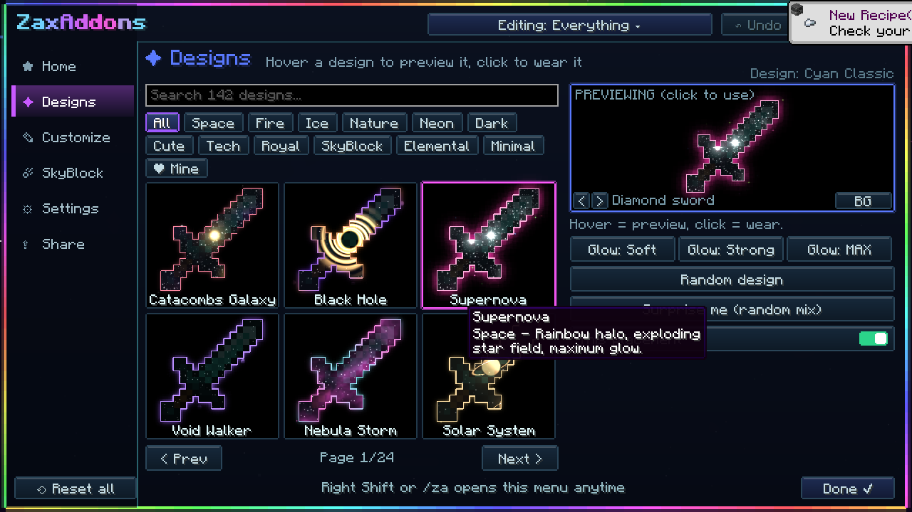
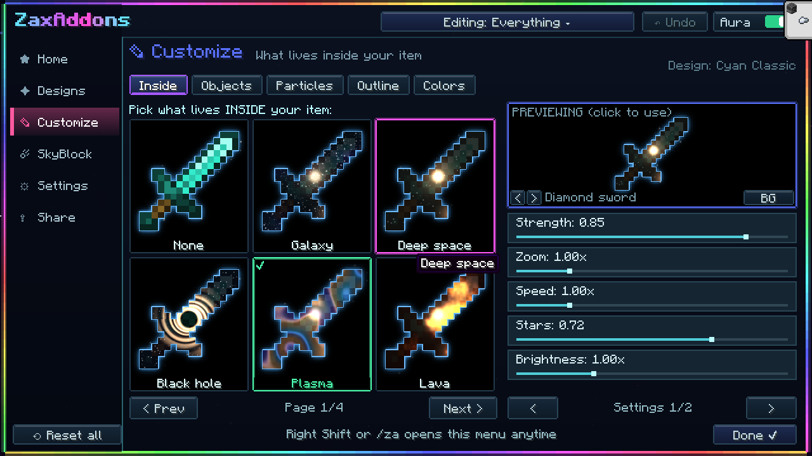

# ✦ Zax Addons ✦

**Neon outlines, glowing effects and SkyBlock helpers for Minecraft 26.1.2 (Fabric)**

---

## ✨ What it does

| | |
|---|---|
|  | **Effects inside your items:** galaxies, black holes, fire, plasma, aurora and more, with suns, planets, comets and hearts floating inside. |
|  | **Neon outlines** on the item in your hand, your hotbar, inventory, armor and the item on your cursor. Every place can have its own look. |
|  | **SkyBlock rarity colors:** Common through Mythic and Divine read straight from the item, plus slot backgrounds and sparkles on recombobulated items. |

### Easy menu, open it with `/za` or **Right Shift**

- **Home:** click your helmet, chestplate, held item or player to style each one
- **Designs:** 140+ ready-made looks. Hover to preview, click to wear
- **Customize:** inside effect, floating objects, particles, outline and colors
- **SkyBlock:** rare drop alerts, dungeon star badges, item IDs in tooltips, rarity colors
- **Settings:** where the aura shows, player glow, menu themes, performance mode
- **Share:** copy a code to share your look, plus loadouts that save every setting

## 📥 Install

1. Install **Fabric Loader** for **Minecraft 26.1.2** ([fabricmc.net](https://fabricmc.net/use/installer/))
2. Download **Fabric API 0.155.3+26.1.2** ([Modrinth](https://modrinth.com/mod/fabric-api))
3. Download the newest **Zax Addons** jar from [**Releases**](../../releases)
4. Put both jars in your `mods` folder and start the game
5. Type `/za`

> 🔒 **Zax Addons is private.** It only works with an access code from the owner. Ask for yours, type `/za`, press **Paste from clipboard** and **Activate**.

## ⚡ Performance
Settings → Menu → **Performance**: *Fast* for the most FPS, *Ultra* for the best looks.

## ✅ Safe
Everything is client side and display only: nothing is automated and nothing is sent to any server.

---

Made for oloking12345 · Zax Addons

